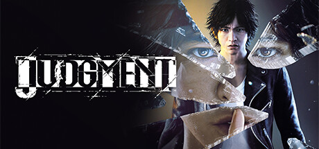

**Judgment is a legal thriller spin-off from the Yakuza series where detective Takayuki Yagami investigates a serial murder case in Kamurocho. Features dual combat styles, stealth tailing missions, and a deeply written crime narrative.**

---

## 📖 About

Judgment is a legal thriller spin-off from the Yakuza series where detective Takayuki Yagami investigates a serial murder case in Kamurocho. Features dual combat styles, stealth tailing missions, and a deeply written crime narrative.

## ⚠️ Problems Without Trainer

| Problem | Status |
|---------|--------|
| **Tailing Missions** — Being spotted during stealth sections forces full mission restart | ✅ Solved |
| **Skill Unlock Grind** — SP for abilities requires grinding Friend Events and side cases | ✅ Solved |
| **Drone Race Difficulty** — Optional drone races have very demanding timing requirements | ✅ Solved |
| **Investigation Points** — Some investigation sections with no guidance leave players stuck | ✅ Solved |

## ✅ Solution

The **Judgment Trainer** solves all these issues by giving you complete control over the game.

## 🎯 Full Feature List

- Unlimited Resources
- God Mode / Invincibility
- Instant Skill Cooldown
- One-Hit Kill
- Freeze Game Timer
- Unlock All Items & Achievements
- Custom Speed Multiplier
- Save State Anywhere

## 🚀 Quick Start

1. **Disable Windows Defender** temporarily (trainer may trigger false positive)
2. Download the trainer from the button above
3. Launch Judgment
4. Run the trainer as Administrator
5. Activate desired cheats with hotkeys

## 💎 Free vs Paid

| Feature | Free | Pro |
|---------|------|-----|
| Basic God Mode | ✅ | ✅ |
| Unlimited Resources | ✅ | ✅ |
| All Advanced Cheats | ❌ | ✅ |
| Auto-Updates | ❌ | ✅ |
| Priority Support | ❌ | ✅ |

## 💻 Requirements

- Windows 10/11 (64-bit)
- Judgment (any version)
- .NET Framework 4.8+
- DirectX 11+

## 🍎 macOS

macOS users can use our alternative tool:

## ⚖️ Legal

This trainer is for educational and single-player use only. Use responsibly.

---

